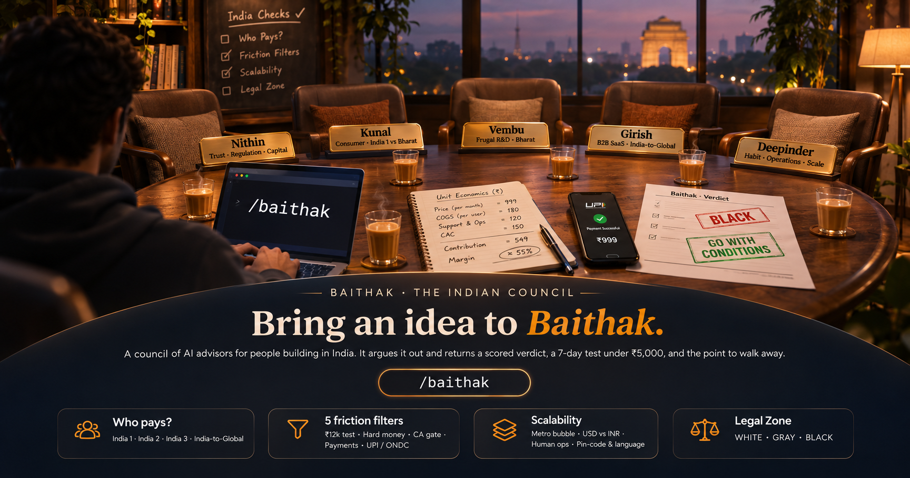

# Baithak

**Baithak** (बैठक, "a sitting, a meeting") is a council of AI advisors for people building in India. Bring an idea or a hard decision. Advisors argue it out over two or three rounds, and a Chair hands back a scored verdict: the call, the strongest objection, a 7-day test you can run for under ₹5,000, and the point at which you should walk away.

It runs inside [Claude Code](https://claude.com/claude-code). Your Claude plan covers it; no API key needed.

## Why it is different

Most idea validators were built for the US. India breaks them. Baithak's Chair runs the checks they skip, before any advisor speaks:

- **Who pays:** India 1, India 2, India 3, or India-to-Global. Mixing them is a failure on its own.
- **What kind of business it is:** eight idea types, each with its own checks (below). A pickle brand and a SaaS tool are not judged by the same rules.
- **Friction filters:** the ₹12,000 employee test, the hard-money anchor, the CA or munim gatekeeper, UPI and collection friction, public rails like UPI and ONDC.
- **Scalability:** the metro bubble, USD costs against INR revenue, linear human ops, pin-code and language walls.
- **Legal zone:** WHITE, GRAY, or BLACK, cited only from a dated `laws/` folder with sources. A BLACK idea cannot get a GO, however much the advisors like it.

## The council

Each advisor is built from one Indian founder's public interviews, podcasts, talks and letters. Every quote is verbatim, carries a source id, and is checked by a script on every run.

| Seat | Pillar | The question they own | Built from |
|---|---|---|---|
| Nithin Kamath | Trust, regulation, capital discipline | Will Indians trust you with their money or data without you burning cash to buy them? | 9 sources |
| Kunal Shah | Consumer behaviour, India 1 vs Bharat | Is this a big enough leap over today's jugaad that nobody goes back? | 10 sources |
| Girish Mathrubootham | B2B SaaS, India-to-global | Why sell this for ₹999 in India when the world will pay $500? | 11 sources |
| Sridhar Vembu | Frugal R&D, Bharat, bootstrapping | Can you build real depth cheaply, outside the metro bubble, without VC money? | 11 sources (business views only) |
| Deepinder Goyal | Consumer habit, operations at scale | Is this a daily habit, and what breaks at 10,000 orders a day? | 13 sources |

All five are seed depth (about 65,000 to 125,000 words each). They will get deeper as sources are added; see Contributing.

## What it covers

| Idea type | Examples | Extra checks |
|---|---|---|
| Software and SaaS | B2B tools, MSME software, APIs | Gross margin after cloud and AI cost, payback, India-to-global pricing |
| Consumer app and content | Social, content, games, communities | Delta 4 over today's habit, retention, revenue per user outside India 1 |
| Marketplace | Delivery, services, B2B trade | Liquidity, off-platform leakage, take rate |
| Physical product and D2C | Food, FMCG, cosmetics, apparel | Gross margin after cost of goods, channel margin stack, working capital, COD returns, certification |
| Manufacturing and hardware | Factories, devices, EVs | Capex and utilisation, import dependence, certification lead time |
| Service business | Agencies, consulting, coaching, clinics | Founder dependence, utilisation, productisation, client concentration |
| Local business | Shops, restaurants, cloud kitchens, franchises | Rent share, break-even orders, aggregator commission |
| Regulated sector | Fintech, health, education, real estate, insurance | Added on top of any type, with a stricter legal bar |

**Law files (24):** payments, digital lending, deposits and pooled investment, SEBI advice and finfluencers, crypto, Aadhaar, UPI e-mandates, DPDP, IT Rules, consumer protection, online gaming, GST, telemedicine and e-pharmacy, FSSAI, packaging labels, advertising and endorsements, BIS quality marks, pollution consents and EPR, import-export and FEMA, cosmetics and medical devices, labour codes, insurance (IRDAI), RERA, coaching and education. Each file has its sources, a `last_verified` date, and a "Watch for" list of what is still unverified. Anything not covered comes back as UNMAPPED, with the regulator to check, never as WHITE.

## Install

**Option 1: as a Claude Code plugin (recommended).** Inside Claude Code:

```
/plugin marketplace add cipher-cmd/Baithak
/plugin install baithak@baithak
```

On recent Claude Code versions this also works in one step: `/plugin install baithak --marketplace cipher-cmd/Baithak`. Plugin skills are namespaced, so the command is `/baithak:baithak`; asking "run a baithak on my idea" also triggers it.

**Option 2: clone the repo.** Use this if you want to build new advisors or edit the law files.

```bash
git clone https://github.com/cipher-cmd/Baithak.git
cd Baithak
claude
```

Then type `/baithak`. You need Python 3 for the quote and law checkers. Node.js 20+ and `yt-dlp` are only needed to build new advisors.

Everything the council needs lives in one folder, `.claude/skills/baithak/`: the seats (`seats/`), their brains (`brains/`), the law files (`laws/`), the Chair's references and the checker scripts. Councils are saved to `sessions/` in whatever project you run it from.

## Use it

Type `/baithak` and your idea. Give it as much of this as you can: the idea in one line, who pays and how, what customers do today instead, how you will reach your first 20 customers, your budget and time, and which way you are leaning.

```
/baithak --quick I want to build a WhatsApp GST billing assistant for hardware shops in
Tier-2 cities at ₹999/month. Today their munim does it in a notebook and Tally. I'd sell
through local CAs. I have ₹3 lakh and 6 months. Leaning yes because CAs I spoke to liked it.
```

**Pick who sits at the table:**

| You want | Type |
|---|---|
| The council it recommends for your idea | `/baithak <idea>`, then choose **Recommended board** |
| Only some advisors | `/baithak --seats deepinder,vembu <idea>`, or choose **Choose seats** and tick them |
| One advisor's view | `/baithak ask nithin <question>` |
| Everyone | `/baithak --all <idea>` |
| A cheaper run | add `--quick` (four seats, two rounds) |
| To change your default board | `/baithak board` |

Councils are saved in `sessions/<date>-<idea>/`: the brief, the India checks, every round, and the verdict.

**See a real run:** [`sessions/2026-11-10-example-fantasy-cricket/verdict.md`](sessions/2026-11-10-example-fantasy-cricket/verdict.md). A paid fantasy cricket app is vetoed as BLACK under the online gaming law, and the council splits on a free version until it agrees on a zero-code test first.

**Cost:** a `--quick` council is eight advisor runs; a full council with five seats is fifteen. Start with `--quick`.

## Build a new advisor

```
/newseat <Full Name>
```

It checks for personality-rights court orders first and stops if it finds one. Then it finds and fetches public sources, screens out garbled transcripts, extracts frameworks and quotes with parallel agents, writes the brain, checks every quote, and registers the seat. The repeatable parts are scripted in `.claude/skills/newseat/scripts/seatkit.py` (`discover`, `fetch`, `plan`, `check`, `finish`, `cost`).

## Important

- **The advisors are simulations** built from public statements. They are not the people named, are not affiliated with or endorsed by them, and do not speak for them. Only verbatim quotes with a source id are attributed to the real person.
- **No portraits, photos, or voices** of real people, ever.
- **Not legal or financial advice.** The legal zone flags what to check. Most law files rest on law-firm and legal-news summaries because official sites block automated reading; each file says what is unverified. GRAY and BLACK always mean: verify with a lawyer before you build.
- **Opt-out:** if you are one of the people an advisor is built from, or represent them, open a ["Remove my seat" issue](../../issues/new?template=remove-my-seat.md). We remove it within 7 days, no questions asked.
- Raw transcripts used to build advisors stay on the builder's machine (`build/` is gitignored). Only the brains ship: summaries and short quotes with links.

## Contributing

The most useful help, in order:

1. **Law files.** CAs, lawyers and compliance people: check a file against the official text, fix it, update `last_verified`. Run `python .claude/skills/baithak/scripts/check_laws.py --lint` before you open a pull request.
2. **Missing laws.** State shop and trade licences, FDI rules for e-commerce, drones, agri-marketing, AI rules. Use the template in `.claude/skills/baithak/laws/README.md`.
3. **Deeper advisors.** Suggest long, public sources (their own writing beats interviews) for an existing seat.
4. **New advisors.** Propose a person in an issue. We run the court-order check ourselves before building.
5. **Real sessions.** Run Baithak on your idea and tell us where the Chair or an advisor got it wrong.

## Credits

Baithak is a fork of [Roast Room](https://github.com/nateherkai/roast-room) by nateherkai / AI Automation Society (MIT). The council engine, brain format, and seat-building pipeline come from there. The India checks, idea types, legal gate, law files, Indian advisors, Hindi-aware quote checking, and `seatkit` are Baithak's. MIT licence; see `LICENSE`.
